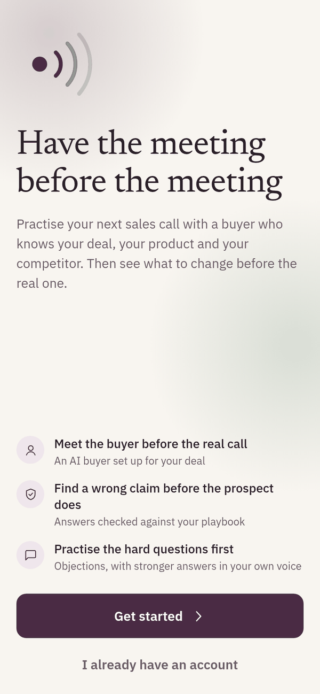
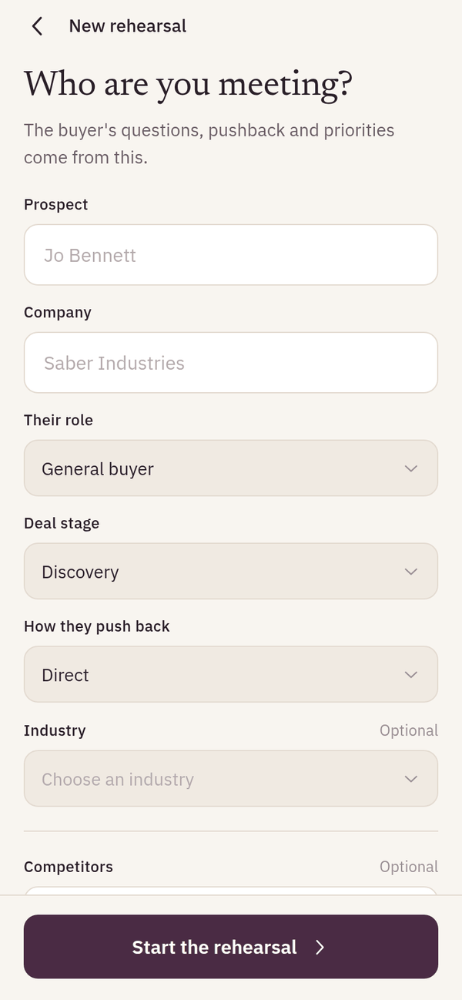
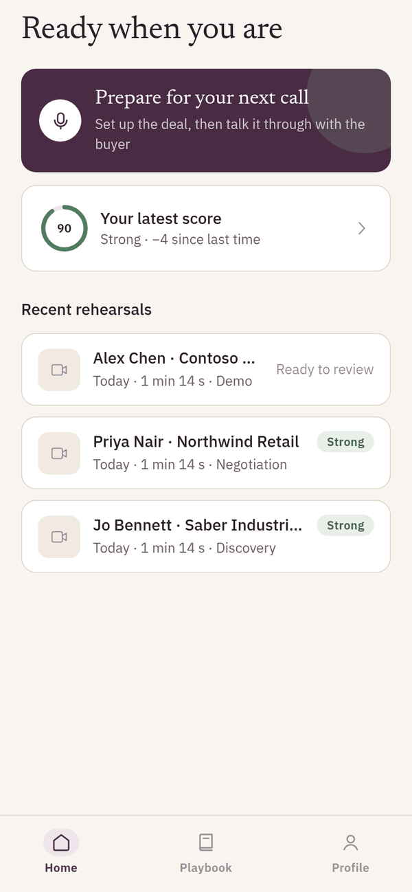
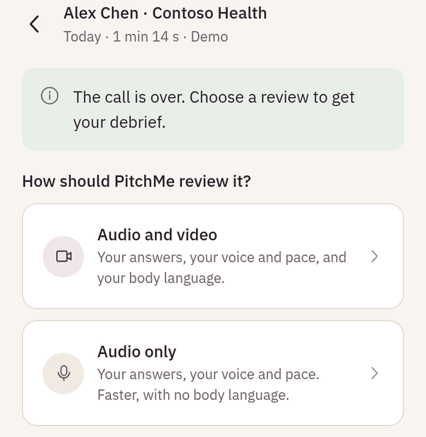
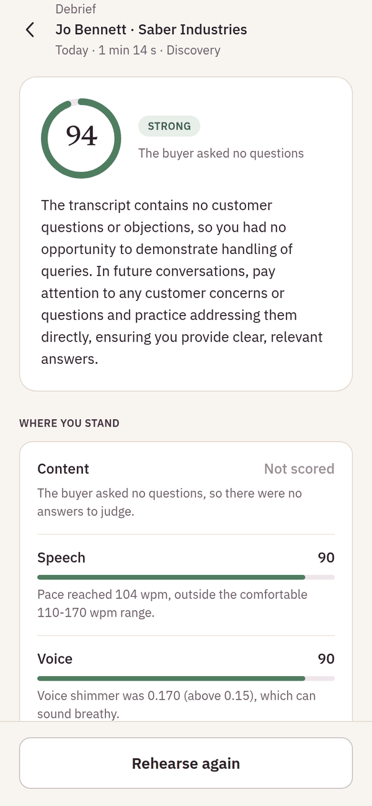
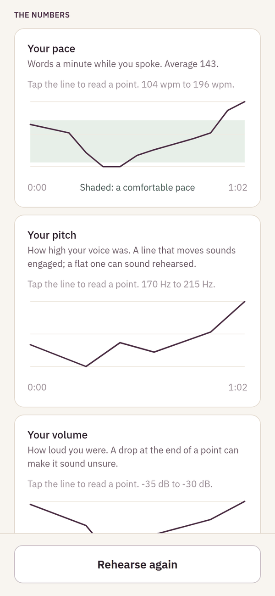
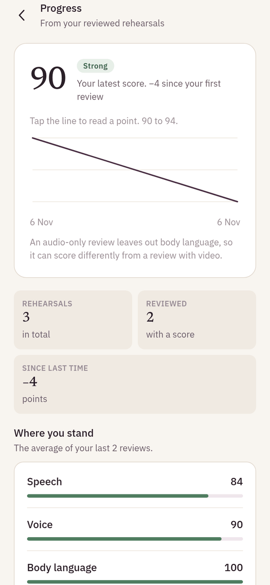
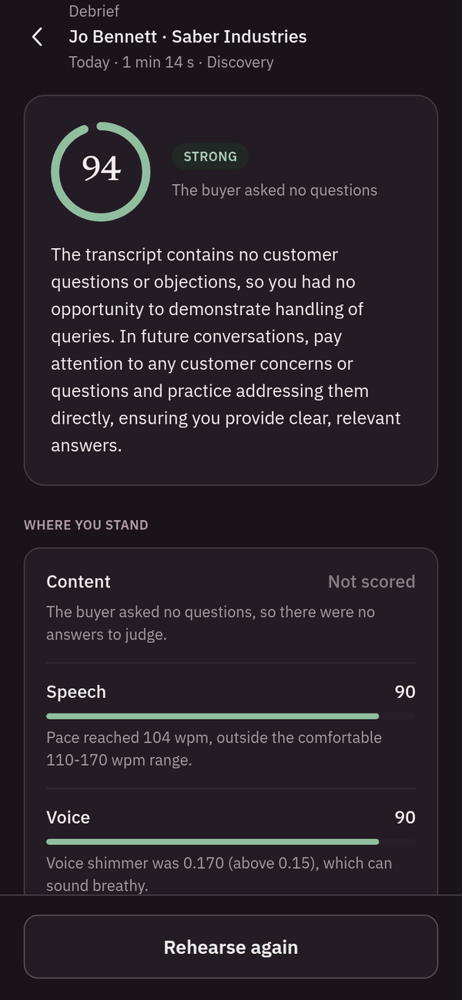
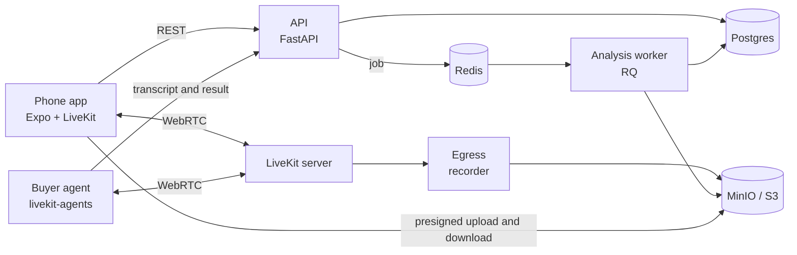
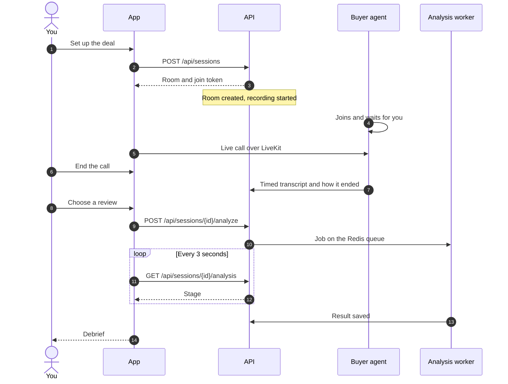

<div align="center">


# PitchMe

**Have the meeting before the meeting.**

A rehearsal room for sales calls. Talk your next deal through with an AI buyer
on a live call, then get a debrief that checks your answers against your own
playbook and plays stronger ones back in your own voice.

[](https://github.com/krishnapriyarajeev/pitchme/actions/workflows/backend.yml)
[](https://github.com/krishnapriyarajeev/pitchme/actions/workflows/app.yml)


[](LICENSE)

</div>

<table>
  <tr>
    <td align="center"><br /><sub>Start</sub></td>
    <td align="center"><br /><sub>Set up the deal</sub></td>
    <td align="center"><br /><sub>Home</sub></td>
    <td align="center"><br /><sub>Choose a review</sub></td>
  </tr>
  <tr>
    <td align="center"><br /><sub>Debrief</sub></td>
    <td align="center"><br /><sub>Delivery over the call</sub></td>
    <td align="center"><br /><sub>Progress</sub></td>
    <td align="center"><br /><sub>Dark mode</sub></td>
  </tr>
</table>

<sub>Screenshots of the web build with real reviews of a test call. The live call itself runs in the phone app.</sub>

## Why

On the real call, it is too late to fix a price quoted from memory, an
objection with no answer ready or a pitch that runs too fast. PitchMe lets
you have the call first, with a buyer who acts like the real one, and shows
you what to fix while there is still time.

The app coaches. It uses no red, the lowest score band is "Needs work", and
every weak spot comes with the next thing to try.

## What it does

- **A buyer set up for your deal.** You name the prospect and company and pick
  their role, the deal stage and how hard they push back. The AI buyer opens
  the call, asks questions and raises objections in that character.
- **A real call.** Camera and microphone go into a LiveKit room. The buyer
  listens with Deepgram, thinks with an LLM on Groq and speaks with Deepgram.
  The server records the call.
- **A review that runs in the background.** Content, speech, voice and body
  language are checked at the same time on a Redis job queue. The app shows
  each stage as the job reports it.
- **Answers checked against your playbook.** Upload a PDF, PowerPoint, Word
  or text file. The debrief flags a wrong price or a claim the playbook does
  not back, and writes a stronger answer with the source.
- **Stronger answers in your own voice.** Record a 20-second voice sample
  once. The debrief plays each stronger answer in a clone of your voice.
- **Your delivery, at the moment it happened.** Pace, filler words, pitch,
  volume, eye contact, posture and gestures, each finding tied to its moment
  in the recording, with an annotated video.
- **Progress over time.** A trend of your scores and the average of each
  dimension over your latest reviews.

## How it works



A rehearsal from start to debrief:



### Scoring

Content is the score the content judge gives. Speech, voice and body language
start at 100 and lose 5, 12 or 20 points for each low, medium or high finding.
The overall score weights the four:

| Dimension | Weight | What it looks at |
|---|---|---|
| Content | 50% | Each buyer question: handled, weak, dodged, inaccurate or not in your playbook |
| Body language | 20% | Posture, eye contact, gestures and expression, from MediaPipe |
| Speech | 15% | Words a minute, pauses, filler words and unclear words |
| Voice | 15% | Pitch range, monotone stretches, volume, jitter and shimmer, from Praat |

A dimension that cannot be scored (no questions asked, or an audio-only
review with no video) says why, and the others share its weight. The worker
finds the buyer's lines in the recording and scores only yours, so the
buyer's voice never counts against you.

## Quick start

You need Docker, [uv](https://docs.astral.sh/uv/), Python 3.11 or 3.12 and
Node 20.19 or later.

**1. Backend**

```bash
cd backend
make dev       # install dependencies, create .env from .env.example
make models    # download the MediaPipe models for body language
make up        # Postgres, MinIO, Redis, LiveKit and Egress in Docker
make migrate   # create the tables
```

Fill in `backend/.env`. You need passwords, `JWT_SECRET`, `AI_CALLBACK_KEY`,
`LIVEKIT_API_SECRET`, and these provider keys:

| Key | For | Needed |
|---|---|---|
| `GROQ_API_KEY` | The buyer's thinking, transcription and the content judge | Yes |
| `DEEPGRAM_API_KEY` | The buyer hearing you and speaking | For live calls |
| `CARTESIA_API_KEY` | Stronger answers in your own voice | Optional |
| `GEMINI_API_KEY` | Gemini instead of Groq for the LLM | Optional |

Then start everything for a phone on your network:

```bash
make practice  # API, analysis worker and buyer agent, with your LAN address
```

**2. App**

```bash
cd app
npm install
cp .env.example .env
scripts/use-lan-ip.sh   # point the app at the API on this computer
```

The live call needs native WebRTC, so the app runs in a development build,
not Expo Go:

```bash
npx eas build --profile development --platform android   # or: npx expo run:android
npm start
```

`npm run web` shows every screen in a browser, but has no live call.

Each part has its own README with the details:
[backend/README.md](backend/README.md) and [app/README.md](app/README.md).

## Project layout

```
pitchme/
├── backend/
│   ├── ai/            Analysis: speech, voice, vision, content, voice cloning,
│   │                  the buyer agent and the pipeline. No HTTP, no database.
│   ├── server/        FastAPI app: routes, services, database, storage, jobs
│   ├── alembic/       Database migrations
│   ├── scripts/       dev.sh, the agent and worker entry points, model download
│   └── tests/         Unit, integration and opt-in live tests
├── app/
│   ├── src/app/       Screens (expo-router: the file name is the route)
│   ├── src/components/ UI kit, motion, charts, call room, debrief sections
│   ├── src/lib/       Typed API client, sign-in storage, helpers
│   └── src/hooks/     Sign-in state, data loading, theme
└── docs/screenshots/
```

`ai/` never imports `server/`, and a test checks this. A script, a test or the
LiveKit worker can run any part of the analysis on its own.

## Tech stack

| Area | Built with |
|---|---|
| App | Expo SDK 57, React Native 0.86, React 19, expo-router, Reanimated 4, TypeScript (strict) |
| Live call | LiveKit (server, Egress, React Native SDK), livekit-agents, Silero VAD |
| API | FastAPI, SQLAlchemy 2, Alembic, Postgres 16, MinIO (S3), JWT |
| Jobs | Redis, RQ |
| Speech to text | Groq Whisper (`whisper-large-v3-turbo`), Deepgram Nova-3 in the call |
| LLM | Groq (`openai/gpt-oss-20b`) or Gemini |
| Voice analysis | Praat (parselmouth) |
| Body language | MediaPipe pose and face landmarks |
| Voice cloning | Cartesia, or Resemble |
| Quality | ruff, pytest, Jest, ESLint, Prettier, GitHub Actions |

## Tests

```bash
cd backend && make check     # ruff and the unit tests (what CI runs)
cd backend && make test-all  # adds the integration tests (needs make up)
cd backend && make test-live # real provider calls; spends quota
cd app && npm run check      # type check, lint, format check and tests
```

The backend has 576 tests and the app has 100. CI runs both on every pull
request. One app test reads the backend's deal choices, so the app and the API
cannot drift apart.

## Design notes

- **No fake data.** With no server, or a failed load, a screen says what went
  wrong and offers to try again. It never shows sample numbers.
- **Nothing secret in a URL.** The call's join token stays in memory, and
  media links are presigned and short-lived.
- **Everything a user owns sits under one folder** in storage
  (`users/<id>/`), and every upload is checked against it.
- **Long work runs as jobs.** A restart never loses a review, and a job that
  stops or never starts is marked failed so it can run again.
- **Accessible by default.** Every control has a label, colour never carries
  meaning alone, and all motion stops when the phone asks for less.

## Status

The backend and the app are complete. Still to do outside the code:

- [ ] Run the live call on a phone in a development build
- [ ] See a debrief with real buyer questions and answers in a cloned voice
- [ ] Try Resemble as the voice-cloning provider

## License

[MIT](LICENSE)
